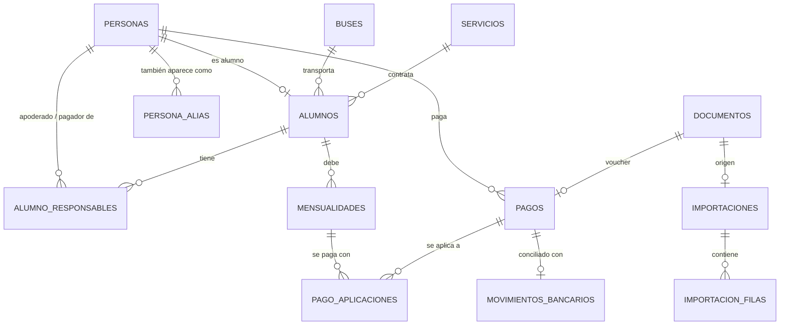

# 3. Base de datos

PostgreSQL 18. Esquema definido en `src/server/db/schema/` (Drizzle) y migraciones SQL en `drizzle/`.

## Modelo (Versión 1)

Transversales: `auditoria`, `reglas_alerta`, `alertas`, `recordatorios`, `cierres_mes`, `configuracion`, `usuarios`, `sesiones`.

## Tablas

| Tabla | Para qué |
|---|---|
| `personas` | Registro único de cada persona (RUT único). Columna calculada `texto_busqueda` para el buscador. |
| `persona_alias` | Nombres alternativos (ej. titular de la cuenta que transfiere). La conciliación "aprende" aquí. |
| `alumnos` | Rol alumno: colegio, curso, bus, servicio, tarifa mensual, día de vencimiento propio, estado. |
| `alumno_responsables` | Relación alumno ↔ persona: apoderado, titular, pagador, parentesco. |
| `buses` / `servicios` | Catálogos. En V2 los buses tendrán documentos y mantenciones. |
| `mensualidades` | Lo que cada alumno debe cada mes. El monto se congela al generarla. |
| `pagos` | Dinero recibido o informado. Estados independientes de **verificación** y **conciliación**. |
| `pago_aplicaciones` | Cuánto de cada pago se aplica a cada mensualidad (pagos parciales y de varios meses). |
| `devoluciones` | Devoluciones de dinero (pendiente / realizada). |
| `movimientos_bancarios` | Cartolas importadas, con huella única para no duplicar (base para V4). |
| `documentos` | Ficha de cada archivo subido; el archivo vive en `storage/`. |
| `importaciones` / `importacion_filas` | Cada carga masiva o lectura por IA, con la propuesta y la decisión de cada fila. |
| `auditoria` | Quién, cuándo, qué (antes/después/cambios), por qué, y si afectó un mes cerrado. |
| `reglas_alerta` / `alertas` | Reglas configurables y alertas generadas (activa, pospuesta, descartada, resuelta). |
| `recordatorios` | Avisos manuales con fecha. |
| `cierres_mes` | Fotografía de los totales de cada mes cerrado. |
| `configuracion` | Parámetros editables (empresa, día de vencimiento, meses de cobro, etc.). |
| `usuarios` / `sesiones` | Acceso y permisos. |

## Convenciones

- **Montos** en pesos chilenos como enteros (`integer`), sin decimales.
- **Fechas** sin hora como texto ISO `AAAA-MM-DD`; los periodos son el día 1 del mes (`2027-08-01`).
- **Nombres de columnas** en `snake_case` en la base y `camelCase` en el código (Drizzle `casing`).
- **Eliminación lógica** (`eliminado_en`) en personas, alumnos, buses, servicios y documentos.
- **Búsqueda**: `f_unaccent(lower(...))` + índices GIN `pg_trgm` (búsqueda sin tildes y tolerante a errores).
- Toda modificación pasa por un servicio que escribe en `auditoria` dentro de la misma transacción.

## Cambiar el esquema

1. Editar los archivos de `src/server/db/schema/`.
2. `pnpm db:generar` → crea una nueva migración SQL en `drizzle/` (revisarla).
3. `pnpm db:migrar` → la aplica.

Nunca editar una migración ya aplicada en producción; siempre crear una nueva.
